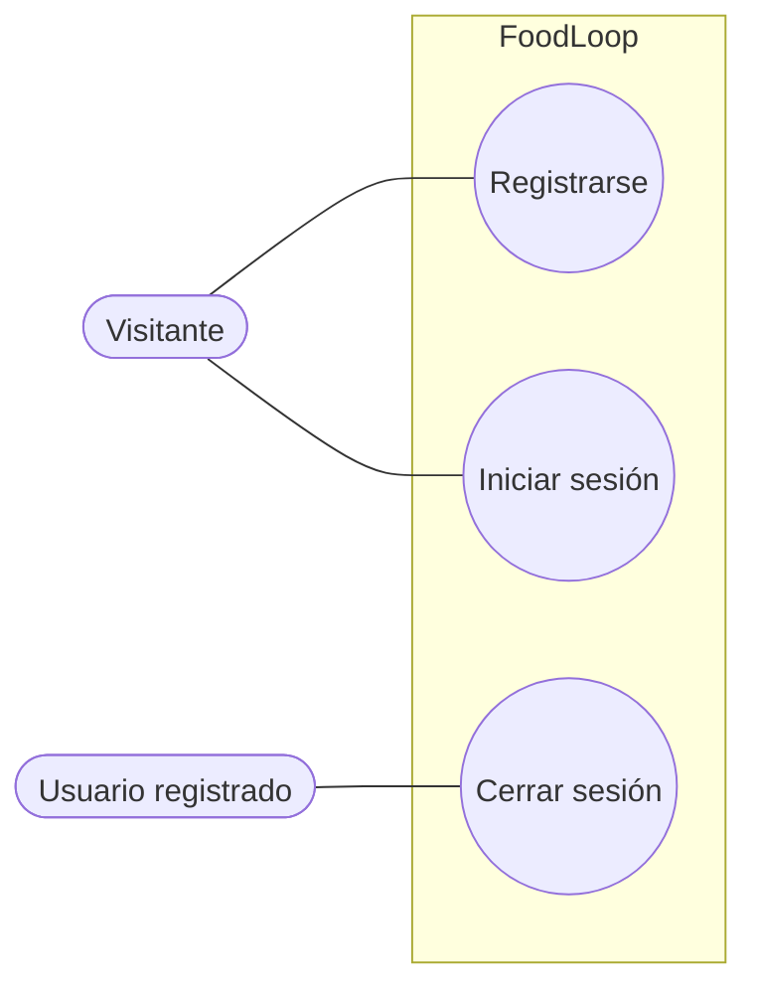

# Autenticación y sesión

Flujo correspondiente: [Autenticación y sesión](../flujo/autenticacion-y-sesion.md)

Código Mermaid (editable)

## CU-01 — Registrarse

- **Actor:** visitante.
- **Meta:** crear una cuenta y recibir un token.
- **Precondición:** el correo no debe estar registrado.
- **Activador:** enviar el formulario de registro.
- **Escenario:** validar campos, comprobar duplicados, aplicar hash, crear usuario, devolver token y entrar al tablero.
- **Excepciones:** correo ya registrado (`400`); contraseña menor de 8 caracteres (`500` por validación); exceso de intentos (`429`).

## CU-02 — Iniciar sesión

- **Actor:** visitante.
- **Meta:** autenticarse y recibir un token.
- **Precondición:** tener cuenta.
- **Activador:** enviar correo y contraseña.
- **Escenario:** buscar usuario, comparar hash, emitir JWT de 30 días, guardar sesión local y entrar al tablero.
- **Excepciones:** usuario inexistente (`400`); contraseña incorrecta (`400`); exceso de intentos (`429`).

## CU-03 — Cerrar sesión

- **Actor:** usuario registrado.
- **Meta:** terminar la sesión en el navegador.
- **Precondición:** haber iniciado sesión.
- **Activador:** pulsar cerrar sesión.
- **Escenario:** eliminar el token local y volver a `/login`.
- **Excepción:** no invalida el token en el servidor; un token copiado seguiría siendo válido hasta expirar.
