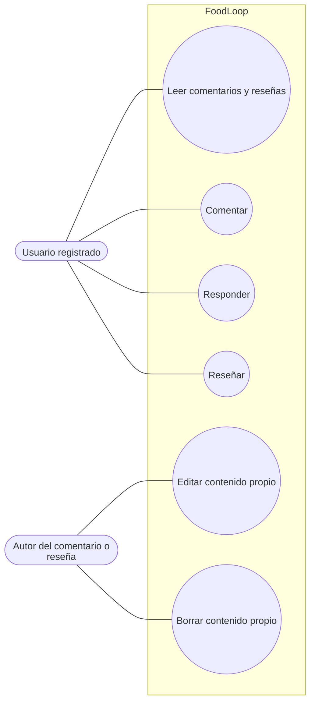

# Comentarios y reseñas

Flujo correspondiente: [Comentarios y reseñas](../flujo/comentarios-y-resenas.md)

Código Mermaid (editable)

## CU-14 — Leer comentarios y reseñas

- **Actor:** usuario registrado.
- **Meta:** ver conversación y valoración de una receta.
- **Precondición:** sesión válida.
- **Activador:** abrir el detalle.
- **Escenario:** pedir comentarios principales con un nivel de respuestas y pedir reseñas ordenadas.
- **Excepciones:** errores de lectura muestran mensajes genéricos.

## CU-15 — Comentar y responder

- **Actor:** usuario registrado.
- **Meta:** participar en la conversación de una receta.
- **Precondición:** sesión válida y texto no vacío.
- **Activador:** publicar comentario o respuesta.
- **Escenario:** guardar el comentario, incrementar el contador, crear actividades para el autor y el autor de la receta, y mostrarlo en el modal.
- **Excepciones:** texto vacío o excesivo; actualmente no se comprueba que la receta exista o sea visible.

## CU-16 — Reseñar

- **Actor:** usuario registrado.
- **Meta:** calificar una receta de 1 a 5 estrellas.
- **Precondición:** sesión válida y puntuación distinta de cero.
- **Activador:** enviar reseña.
- **Escenario:** guardar la reseña, recalcular promedio y total, crear actividad y mostrarla en el modal.
- **Excepciones:** segunda reseña del mismo usuario (`400`); puntuación inválida puede producir `500`.

## CU-17 — Editar o borrar contenido propio

- **Actor:** autor.
- **Meta:** corregir o retirar su comentario o reseña.
- **Precondición:** ser autor.
- **Activador:** usar las operaciones disponibles.
- **Escenario:** actualizar el texto o aplicar borrado lógico en comentarios y recalcular métricas.
- **Estado:** existe en la API, pero actualmente no tiene botones en la interfaz.
