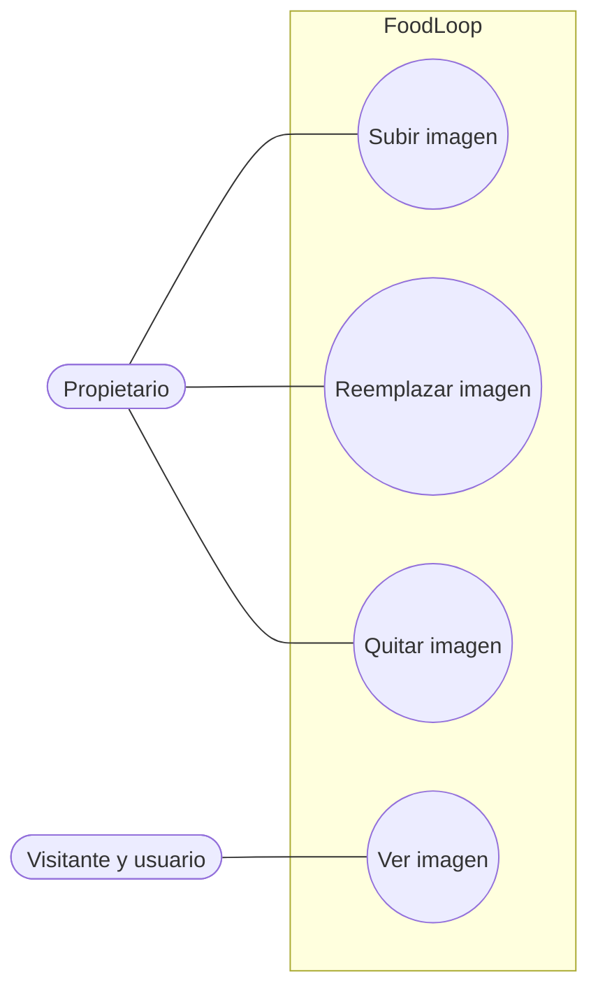

# Imágenes

Flujo correspondiente: [Imágenes](../flujo/imagenes.md)

Código Mermaid (editable)

## CU-07 — Subir imagen

- **Actor:** propietario.
- **Meta:** asociar una imagen optimizada a una receta existente.
- **Precondición:** receta propia creada.
- **Activador:** elegir un archivo y pulsar subir.
- **Escenario:** validar imagen y tamaño, optimizarla en el navegador, enviarla como `multipart/form-data`, guardar el nuevo identificador y borrar la anterior.
- **Excepciones:** archivo no imagen o mayor de 25 MB en el navegador; tipo no permitido o mayor de 5 MB en el servidor (`400`); receta ajena (`404` con borrado de la subida).

## CU-08 — Reemplazar o quitar imagen

- **Actor:** propietario.
- **Meta:** mantener una sola imagen vigente o dejar la receta sin imagen.
- **Precondición:** receta propia.
- **Activador:** elegir otra imagen o eliminar la actual y guardar.
- **Escenario:** registrar el nuevo identificador o cadena vacía y eliminar el archivo anterior de GridFS.
- **Excepciones:** fallo de subida conserva el identificador anterior si no se completó la operación.

## CU-09 — Ver imagen

- **Actor:** cualquier persona con acceso a la URL pública de la imagen.
- **Meta:** mostrar la imagen en tarjetas, detalle o enlace.
- **Precondición:** conocer el identificador del archivo.
- **Activador:** cargar una imagen o abrir su enlace.
- **Escenario:** validar identificador, leer GridFS, devolver tipo de contenido y usar caché inmutable.
- **Excepciones:** identificador inválido (`400`); archivo inexistente (`404`).
