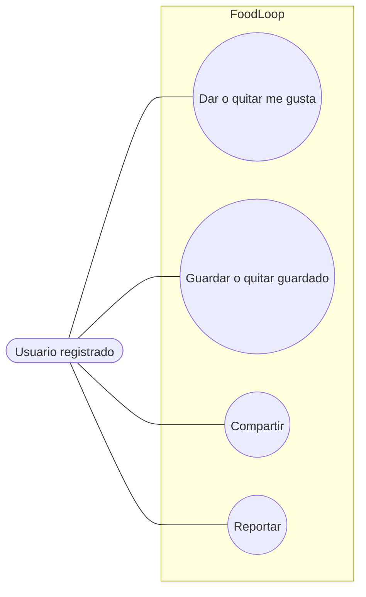

# Interacciones sociales

Flujo correspondiente: [Interacciones sociales](../flujo/interacciones-sociales.md)

Código Mermaid (editable)

## CU-10 — Dar o quitar “me gusta”

- **Actor:** usuario registrado.
- **Meta:** expresar aprobación y mantener el contador.
- **Precondición:** sesión válida.
- **Activador:** pulsar el corazón.
- **Escenario:** alternar el estado, sincronizar receta y favoritos del usuario y registrar actividad para el autor.
- **Excepciones:** receta inexistente (`404`); la interfaz evita el “me gusta” propio, pero la API no lo impide.

## CU-11 — Guardar o quitar guardado

- **Actor:** usuario registrado.
- **Meta:** conservar una receta para consulta posterior.
- **Precondición:** sesión válida.
- **Activador:** pulsar guardar.
- **Escenario:** alternar el arreglo `guardados` y su contador.
- **Excepciones:** receta inexistente (`404`); no sincroniza el arreglo `favoritos` del usuario.

## CU-12 — Compartir

- **Actor:** usuario registrado.
- **Meta:** aumentar el contador de compartidos y registrar actividad.
- **Precondición:** sesión válida.
- **Activador:** pulsar compartir.
- **Escenario esperado:** incrementar el contador y crear actividad `compartio_receta`.
- **Defecto conocido:** ese tipo no está en la enumeración, por lo que la petición puede incrementar el contador y después devolver `500`.

## CU-13 — Reportar

- **Actor:** usuario registrado.
- **Meta:** informar contenido inapropiado.
- **Precondición:** sesión válida.
- **Activador:** enviar un motivo.
- **Escenario:** guardar el reporte, marcar la receta como reportada y sanear el motivo.
- **Excepciones:** receta inexistente (`404`); actualmente admite reportes repetidos.
