# Interacciones sociales

Flujo correspondiente: [Interacciones sociales](../flujo/interacciones-sociales.md)

Código Mermaid (editable)

## CU-10 — Dar o quitar “me gusta”

- **Actor:** usuario registrado.
- **Meta:** expresar aprobación y mantener el contador.
- **Precondición:** sesión válida.
- **Activador:** pulsar el corazón.
- **Escenario:** crear o eliminar la fila en `likes`, recalcular `likesCount` y registrar actividad para el autor.
- **Excepciones:** receta inexistente (`404`); dar “me gusta” a la receta propia (`400`, no puedes dar like a tu propia receta).

## CU-11 — Guardar o quitar guardado

- **Actor:** usuario registrado.
- **Meta:** conservar una receta para consulta posterior.
- **Precondición:** sesión válida.
- **Activador:** pulsar guardar.
- **Escenario:** crear o eliminar la fila en `saves` y recalcular `guardadosCount`.
- **Excepciones:** receta inexistente (`404`).

## CU-12 — Compartir

- **Actor:** usuario registrado.
- **Meta:** aumentar el contador de compartidos y registrar actividad.
- **Precondición:** sesión válida.
- **Activador:** pulsar compartir.
- **Escenario esperado:** incrementar `compartidosCount` y crear actividad `compartio_receta`.
- **Excepciones:** receta inexistente (`404`).

## CU-13 — Reportar

- **Actor:** usuario registrado.
- **Meta:** informar contenido inapropiado.
- **Precondición:** sesión válida.
- **Activador:** enviar un motivo.
- **Escenario:** crear un documento en `reports` con `estado: pendiente` y sanear el motivo.
- **Excepciones:** receta inexistente (`404`); reporte duplicado del mismo usuario (`400`).
