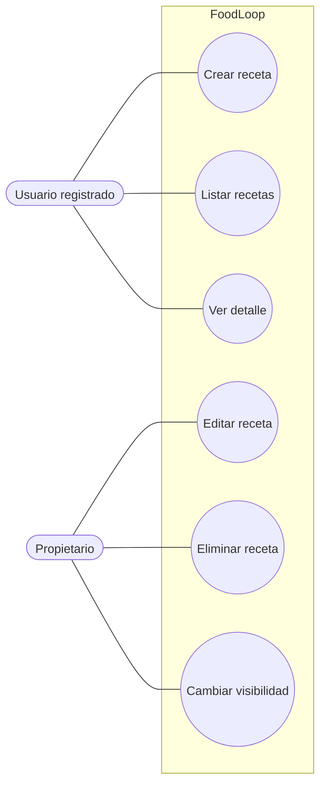

# Recetas y visibilidad

Flujo correspondiente: [Recetas y visibilidad](../flujo/recetas-y-visibilidad.md)

Código Mermaid (editable)

## CU-04 — Crear receta

- **Actor:** usuario registrado.
- **Meta:** guardar una receta propia.
- **Precondición:** sesión válida.
- **Activador:** enviar el formulario de receta.
- **Escenario:** validar ingredientes, conservar solamente campos editables, asignar propietario y devolver `201`.
- **Excepciones:** exceso de creaciones (`429`); error de validación (`500`).

## CU-05 — Listar y ver recetas

- **Actor:** usuario registrado.
- **Meta:** consultar recetas propias o públicas.
- **Precondición:** sesión válida.
- **Activador:** abrir el tablero o una receta.
- **Escenario:** pedir recetas propias o públicas, aplicar filtros locales y abrir el detalle permitido.
- **Excepciones:** receta privada ajena (`404`); identificador inválido puede producir `500`.

## CU-06 — Editar, eliminar y cambiar visibilidad

- **Actor:** propietario.
- **Meta:** actualizar, borrar o publicar una receta.
- **Precondición:** ser propietario.
- **Activador:** guardar cambios, confirmar borrado o confirmar visibilidad.
- **Escenario:** validar propiedad, aplicar lista de campos editables, ejecutar validadores y actualizar la interfaz.
- **Excepciones:** cuerpo sin campos editables (`400`); receta ajena o inexistente (`404`); borrado deja huérfanos comentarios, reseñas y actividad.
