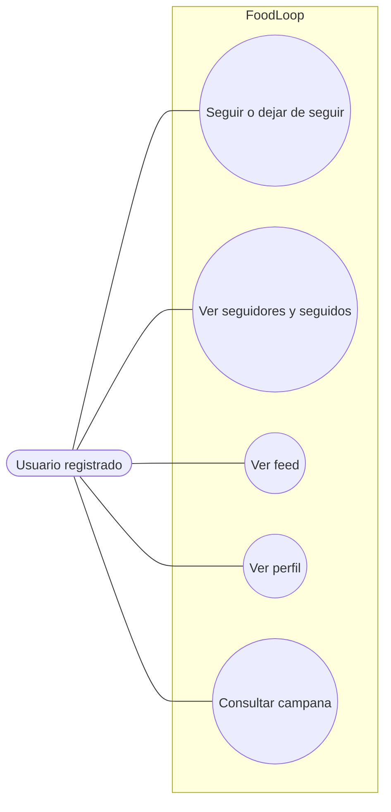

# Seguimiento, feed y notificaciones

Flujo correspondiente: [Seguimiento, feed y notificaciones](../flujo/seguimiento-feed-y-notificaciones.md)

Código Mermaid (editable)

## CU-18 — Seguir o dejar de seguir

- **Actor:** usuario registrado.
- **Meta:** suscribirse o cancelar la suscripción a otro usuario.
- **Precondición:** sesión válida y no ser el mismo usuario.
- **Activador:** pulsar seguir o dejar de seguir.
- **Escenario:** alternar el documento, actualizar ambos contadores y registrar actividad para el usuario seguido.
- **Excepciones:** seguirse a sí mismo (`400`).

## CU-19 — Ver seguidores, seguidos, feed y perfil

- **Actor:** usuario registrado.
- **Meta:** explorar relaciones y actividad.
- **Precondición:** sesión válida.
- **Activador:** abrir listas, feed o perfil.
- **Escenario:** pedir seguidores, seguidos, actividades paginadas y actividad por usuario.
- **Defecto conocido:** `/profile/:username` envía un nombre donde el backend espera un identificador, por lo que el usuario, recetas y seguimiento del perfil no se resuelven correctamente.

## CU-20 — Consultar campana

- **Actor:** usuario registrado.
- **Meta:** revisar actividad reciente.
- **Precondición:** sesión válida.
- **Activador:** abrir la campana.
- **Estado:** provisional. Reutiliza el feed, filtra actividades propias en el navegador, marca todas como no leídas y la acción de leer solamente modifica la memoria local.
- **Pendiente:** modelo, endpoints, persistencia, contador real y validación completa en la Fase 7.
