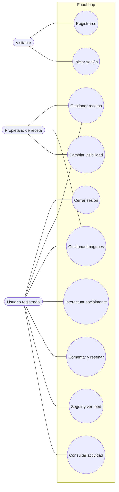

# Casos de uso del sistema general

Flujo correspondiente: [Sistema general](../flujo/sistema-general.md)

Código Mermaid (editable)

## Catálogo general

| ID | Caso de uso | Actor principal | Estado |
|---|---|---|---|
| CU-01 | Registrarse | Visitante | Implementado |
| CU-02 | Iniciar sesión | Visitante | Implementado |
| CU-03 | Cerrar sesión | Usuario registrado | Implementado localmente |
| CU-04 | Gestionar recetas | Propietario | Implementado |
| CU-05 | Consultar recetas públicas | Usuario registrado | Implementado |
| CU-06 | Cambiar visibilidad | Propietario | Implementado |
| CU-07 | Gestionar imágenes | Propietario | Implementado |
| CU-08 | Dar me gusta, guardar, compartir o reportar | Usuario registrado | Implementado con defecto conocido en compartir |
| CU-09 | Comentar y reseñar | Usuario registrado | Implementado con lectura limitada y edición sin interfaz |
| CU-10 | Seguir usuarios y consultar feed | Usuario registrado | Implementado con defecto conocido en perfil |
| CU-11 | Consultar notificaciones | Usuario registrado | Provisional; no hay notificaciones persistentes |
| CU-12 | Buscar recetas, usuarios o etiquetas | Usuario registrado | No implementado |
| CU-13 | Ver perfil público por nombre de usuario | Usuario registrado | No implementado correctamente |

Los casos no implementados o defectuosos se detallan en cada proceso y en la Fase 7 del DERCAS.
