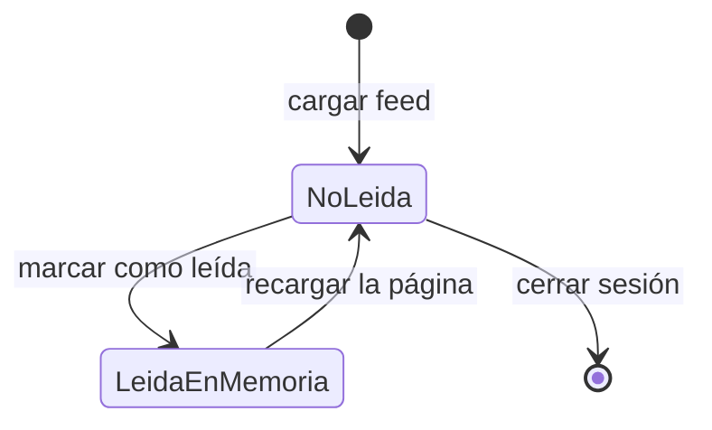

# Estado de la campana de notificaciones

La campana es provisional: reutiliza el feed y no persiste el estado de lectura.

Código Mermaid (editable)

## Notas

- El contador de no leídas es la longitud de la lista, no un estado real.
- `markAsRead()` solo modifica el arreglo en memoria del navegador.
- El modelo `Notification` con `destinatario`, `leida` e índice
  `{ destinatario: 1, leida: 1, createdAt: -1 }` está especificado pero no
  implementado (Fase 7).
