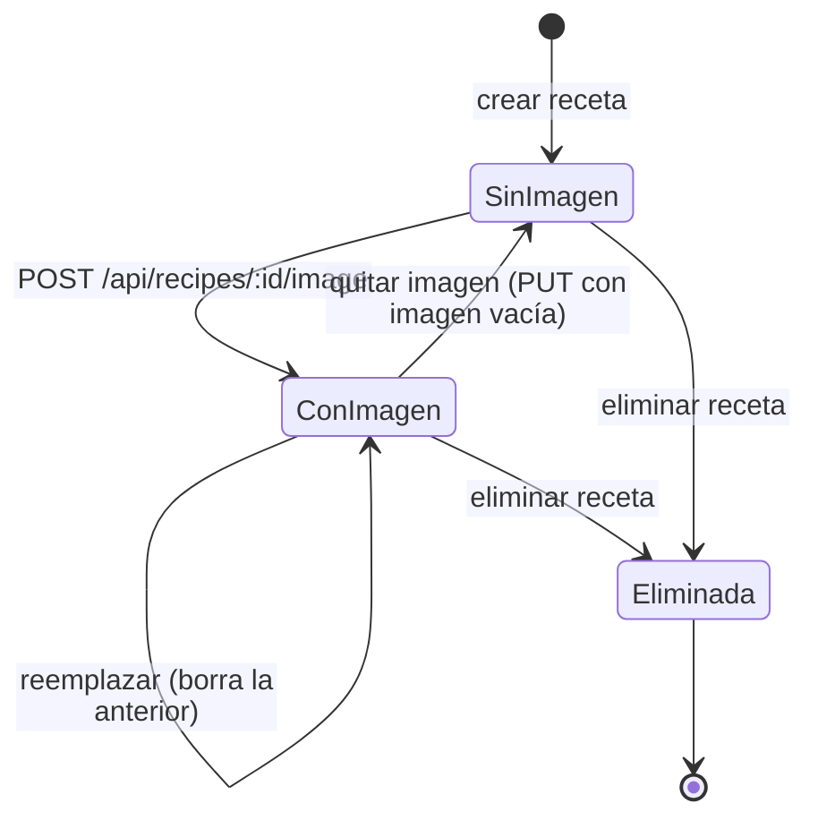

# Ciclo de vida de la imagen

Solo se conserva una imagen vigente por receta. El archivo anterior se elimina
de GridFS al reemplazar, quitar o borrar la receta.

Código Mermaid (editable)

## Notas

- La lectura `GET /api/recipes/image/:fileId` es pública y usa caché inmutable.
- La validación real de bytes (magic bytes) está pendiente; solo se comprueba el
  tipo MIME declarado y un máximo de 5 MB en el servidor.
