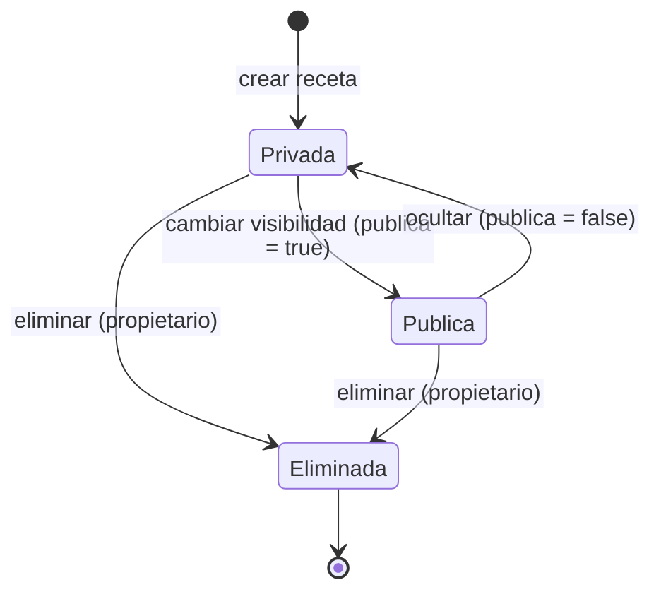

# Ciclo de vida de la receta

La receta nace privada. La visibilidad es un atributo del documento y el borrado
es físico: no hay borrado lógico ni cascada.

Código Mermaid (editable)

## Notas

- Los reportes son documentos aparte en `reports`; no cambian la visibilidad ni
  el estado de la receta. Cada reporte tiene su propio ciclo de moderación
  (`pendiente`, `descartado`, `resuelto`).
- No existe estado de moderación de recetas ni cuenta administradora.
- Al eliminar, se borra la receta, su imagen GridFS y sus filas en `likes`,
  `saves` y `reports`; quedan huérfanos los comentarios, reseñas y actividades.
