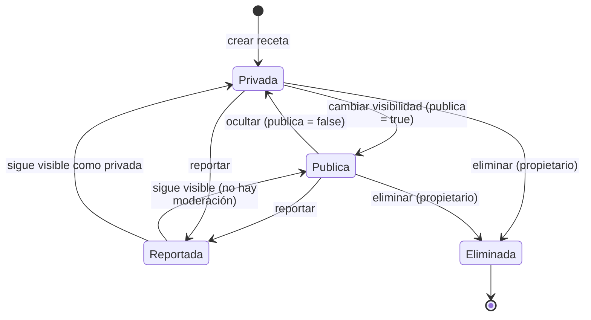

# Ciclo de vida de la receta

La receta nace privada. La visibilidad y el reporte son atributos del documento,
y el borrado es físico: no hay borrado lógico ni cascada.

Código Mermaid (editable)

## Notas

- `reportado` es un booleano independiente; una receta reportada no cambia de
  visibilidad ni deja de ser consultable.
- No existe estado de moderación ni cuenta administradora.
- Al eliminar, se borra la receta y su imagen GridFS, pero quedan huérfanos los
  comentarios, reseñas y actividades asociados.
