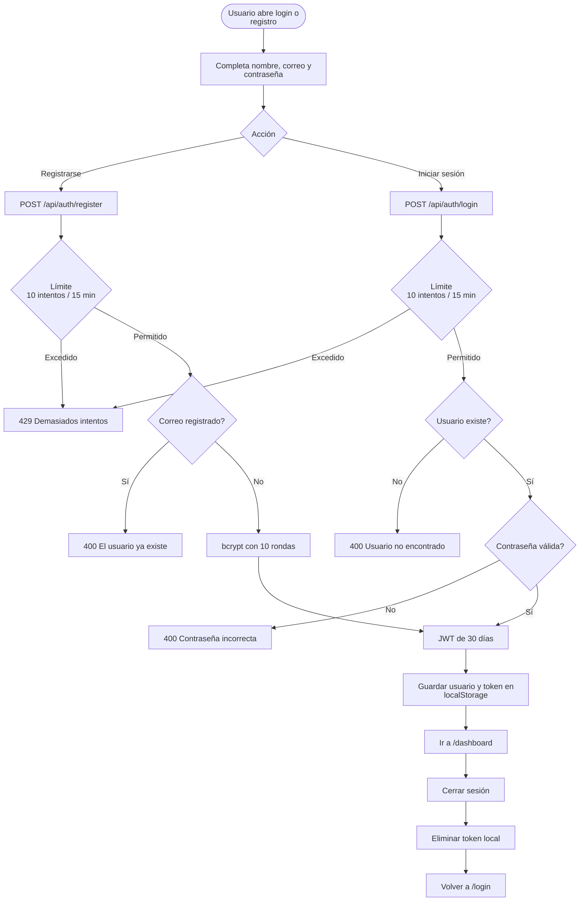

# Autenticación y sesión

Rutas: `/login`, `/register`  
Casos de uso: [Autenticación y sesión](../casos-uso/autenticacion-y-sesion.md)

Código Mermaid (editable)

## Endpoints y validaciones

| Paso | Detalle real |
|---|---|
| Registro | Sanea `name` y `email`; exige nombre, correo, contraseña mínima de 8 caracteres y correo único en minúsculas. |
| Inicio de sesión | Compara el hash con `bcrypt.compare`; no sanea explícitamente la contraseña. |
| Sesión | El token no se invalida en el servidor; cerrar sesión solamente elimina el token del navegador. |
| Rutas protegidas | `AuthGuard` exige la presencia del token, pero no comprueba su expiración antes de llamar al backend. |
