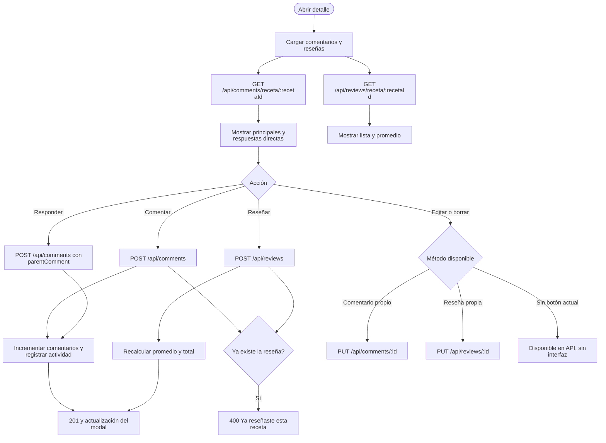

# Comentarios y reseñas

Superficie: modal de detalle en el tablero  
Casos de uso: [Comentarios y reseñas](../casos-uso/comentarios-y-resenas.md)

Código Mermaid (editable)

## Endpoints y validaciones

| Paso | Detalle real |
|---|---|
| Lectura de comentarios | Devuelve comentarios principales no eliminados y un nivel de respuestas. |
| Lectura de reseñas | Devuelve todas las reseñas ordenadas por fecha descendente. |
| Crear comentario o respuesta | Texto obligatorio hasta 1000 caracteres; crea actividad propia y, si aplica, para el autor. |
| Crear reseña | Puntuación obligatoria de 1 a 5 y texto opcional hasta 2000 caracteres; una reseña por usuario y receta. |
| Editar o borrar | Existe en la API con control de autor, pero actualmente no tiene botones en la interfaz. |
| Borrado de comentarios | Es lógico; puede dejar respuestas visibles si solamente se elimina el comentario padre. |
