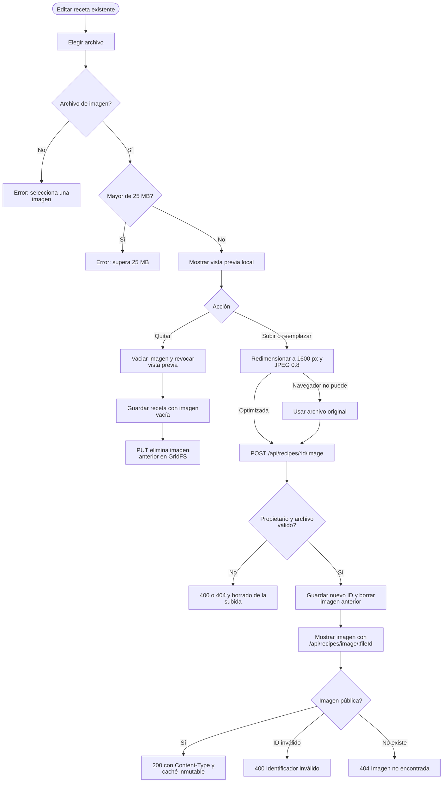

# Imágenes

Ruta: `/recipe/:id` en modo edición  
Casos de uso: [Imágenes](../casos-uso/imagenes.md)

Código Mermaid (editable)

## Endpoints y validaciones

| Paso | Detalle real |
|---|---|
| Selección | Acepta cualquier tipo cuyo MIME comience con `image/` y archivos hasta 25 MB. |
| Optimización | Convierte y reduce al lado mayor de 1600 px en JPEG calidad `0.8`; usa el original si falla. |
| Subida | Usa `multipart/form-data` con el campo `imagen`; no necesita cabecera manual `Content-Type`. |
| Servidor | Acepta JPEG, PNG, WebP y GIF según el tipo declarado y archivos hasta 5 MB; no verifica los bytes reales. |
| Limpieza | Al reemplazar, quitar mediante formulario o borrar receta, elimina el archivo anterior o asociado de GridFS. |
| Visualización | La lectura es pública para permitir ``; devuelve tipo de contenido y caché de un año. |
