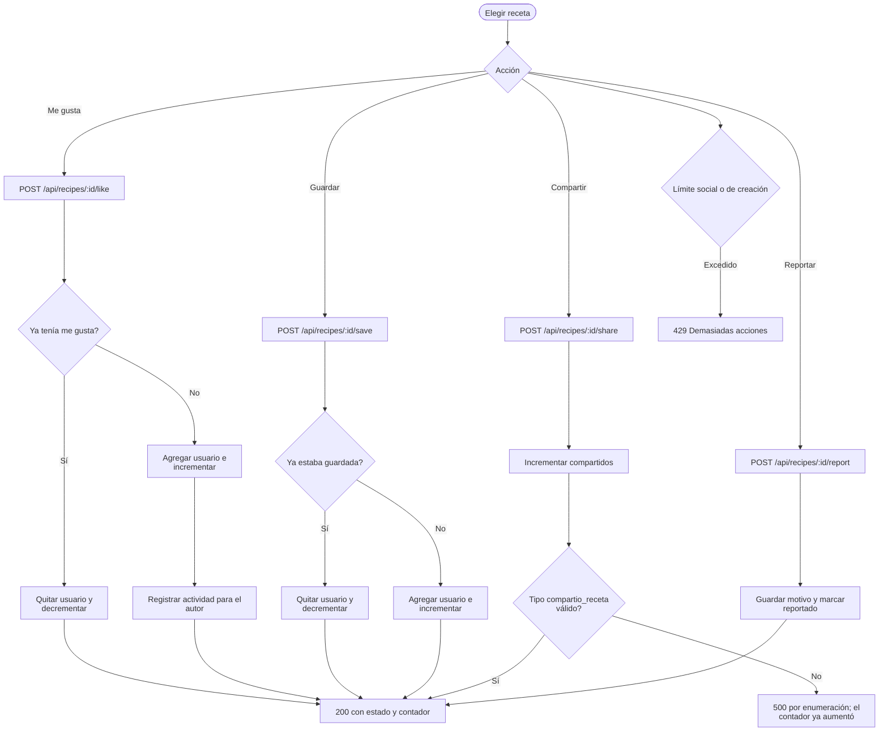

# Interacciones sociales

Superficie: tarjetas y modal del tablero  
Casos de uso: [Interacciones sociales](../casos-uso/interacciones-sociales.md)

Código Mermaid (editable)

## Endpoints y validaciones

| Paso | Detalle real |
|---|---|
| Me gusta | Alterna el estado, mantiene usuario y receta sincronizados y crea actividad para el autor. La interfaz evita el “me gusta” propio, pero el backend no lo impide. |
| Guardar | Alterna el estado solamente en la receta; no usa el mismo arreglo de favoritos del usuario. |
| Compartir | Incrementa el contador; actualmente falla después por un valor fuera de la enumeración permitida. |
| Reportar | Agrega el reporte, marca la receta y sanea el motivo; permite reportes repetidos. |
| Límites | Las interacciones usan 30 acciones por minuto y los reportes usan el límite de creación. |
