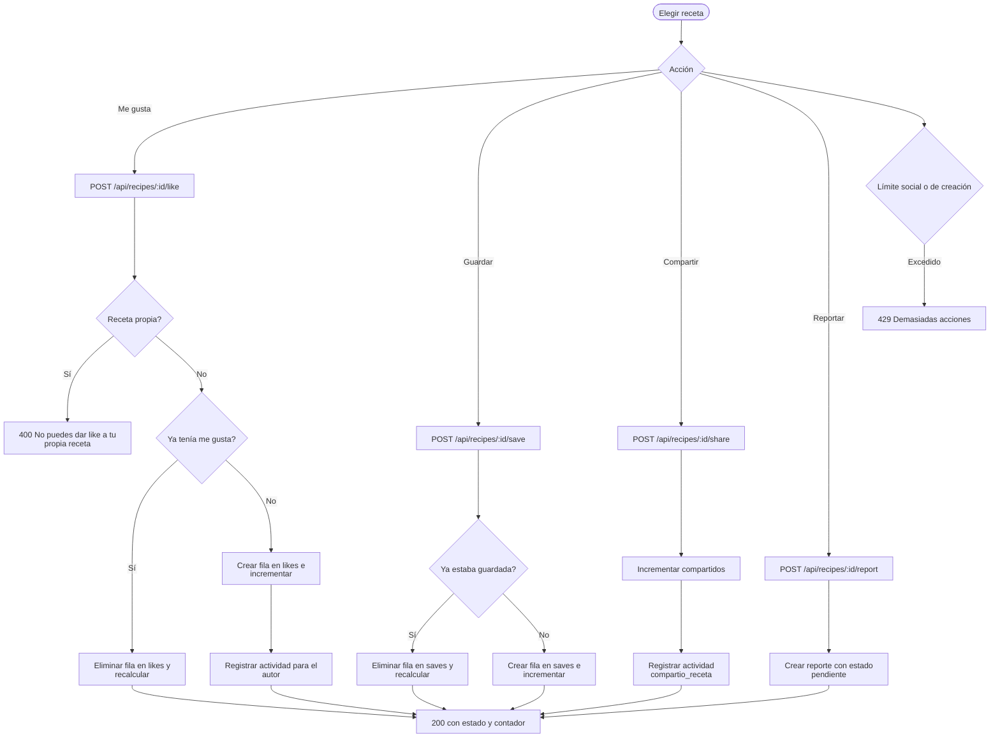

# Interacciones sociales

Superficie: tarjetas y modal del tablero  
Casos de uso: [Interacciones sociales](../casos-uso/interacciones-sociales.md)

Código Mermaid (editable)

## Endpoints y validaciones

| Paso | Detalle real |
|---|---|
| Me gusta | Crea o elimina una fila en `likes`, recalcula `likesCount` con `countDocuments` y crea actividad `likio_receta` para el autor al dar like. Dar like a la receta propia responde `400`. |
| Guardar | Crea o elimina una fila en `saves` y recalcula `guardadosCount`. Es el único mecanismo de favorito personal. |
| Compartir | Incrementa `compartidosCount` y registra actividad `compartio_receta`, ya incluida en la enumeración. |
| Reportar | Crea un documento en `reports` con `estado: pendiente` y sanea el motivo; un segundo reporte del mismo usuario responde `400`. |
| Límites | Las interacciones usan 30 acciones por minuto y los reportes usan el límite de creación. |
