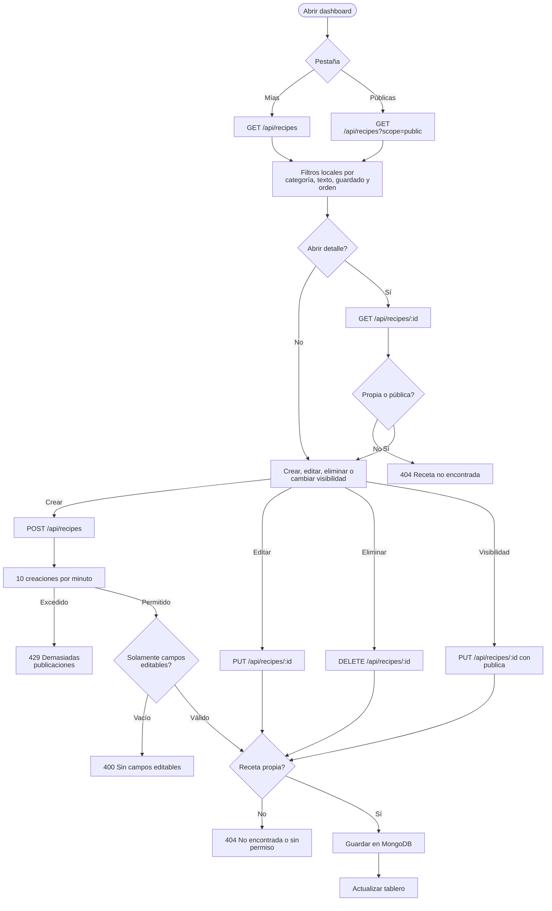

# Recetas y visibilidad

Rutas: `/dashboard`, `/recipe`, `/recipe/:id`  
Casos de uso: [Recetas y visibilidad](../casos-uso/recetas-y-visibilidad.md)

Código Mermaid (editable)

## Endpoints y validaciones

| Paso | Detalle real |
|---|---|
| Crear | Acepta 11 campos editables; el servidor asigna el propietario y descarta `_id`, `usuario`, contadores y métricas. |
| Listar | Sin paginación ni búsqueda en el servidor; los filtros actuales son del navegador. |
| Detalle | Permite la receta si pertenece al usuario o es pública. |
| Editar | Exige ser propietario y ejecuta validadores Mongoose; puede devolver `500` con identificadores inválidos. |
| Eliminar | Exige ser propietario; elimina la receta, su imagen GridFS y sus filas en `likes`, `saves` y `reports`; deja huérfanos comentarios, reseñas y actividad. |
| Visibilidad | Campo `publica`; las recetas nacen privadas. Muchas acciones sociales no comprueban actualmente la visibilidad. |
