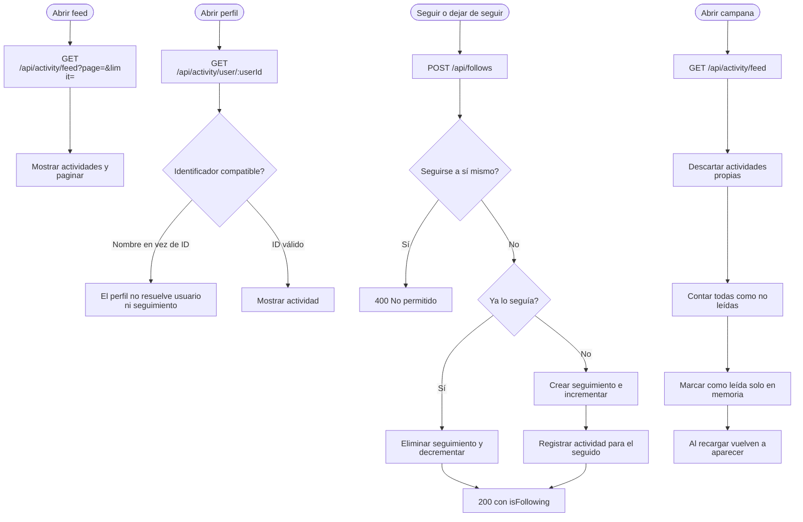

# Seguimiento, feed y notificaciones

Rutas: `/feed`, `/profile/:username`, campana en el tablero  
Casos de uso: [Seguimiento, feed y notificaciones](../casos-uso/seguimiento-feed-y-notificaciones.md)

Código Mermaid (editable)

## Endpoints y validaciones

| Paso | Detalle real |
|---|---|
| Feed | Usa seguidos más el propio usuario, con paginación de 20 por defecto. |
| Perfil | La ruta usa `username`, pero el backend espera un identificador de usuario; por eso el perfil no resuelve correctamente usuario ni seguimiento. |
| Seguimiento | Impide seguirse a sí mismo, alterna el estado y actualiza contadores. |
| Campana | Reutiliza el feed, no persiste lectura y el contador no representa no leídas reales. |
| Formato temporal | La campana calcula mal los minutos, horas y días porque usa la fecha absoluta en lugar de la diferencia con ahora. |
