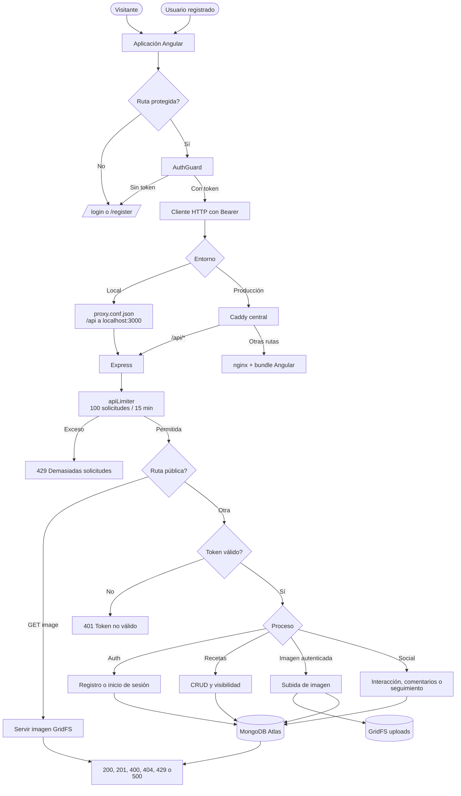

# Flujo general del sistema

## Recorrido de una petición

Código Mermaid (editable)

## Reglas transversales

- Todo `/api`, excepto salud e imagen servida, exige un token válido.
- Los límites pueden devolver `429`.
- Los identificadores inválidos pueden producir `500` por `CastError` donde no hay validación explícita de `ObjectId`.
- Compartir puede incrementar el contador y luego devolver `500` por el valor `compartio_receta`, ausente en la enumeración de actividad.
