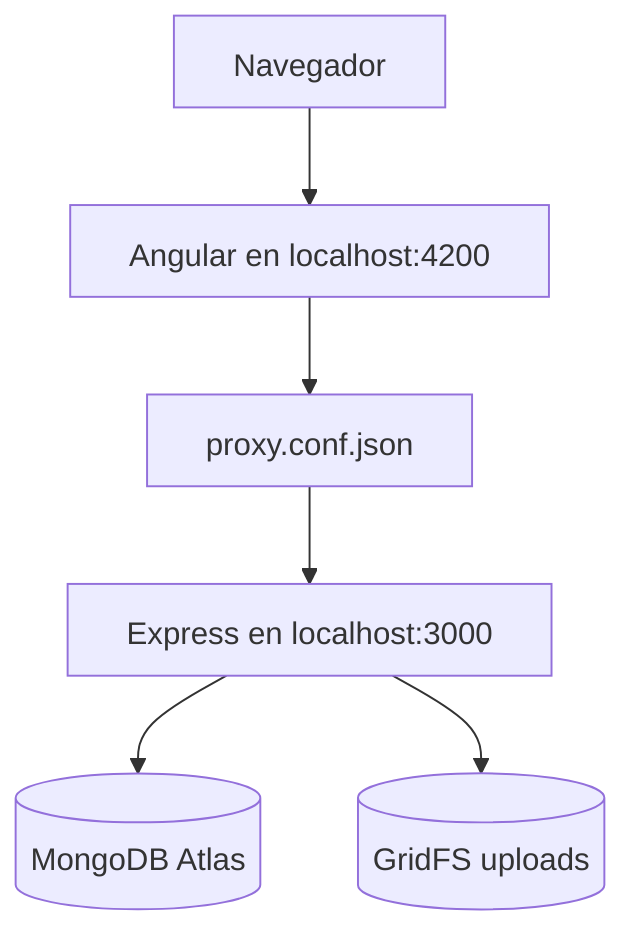
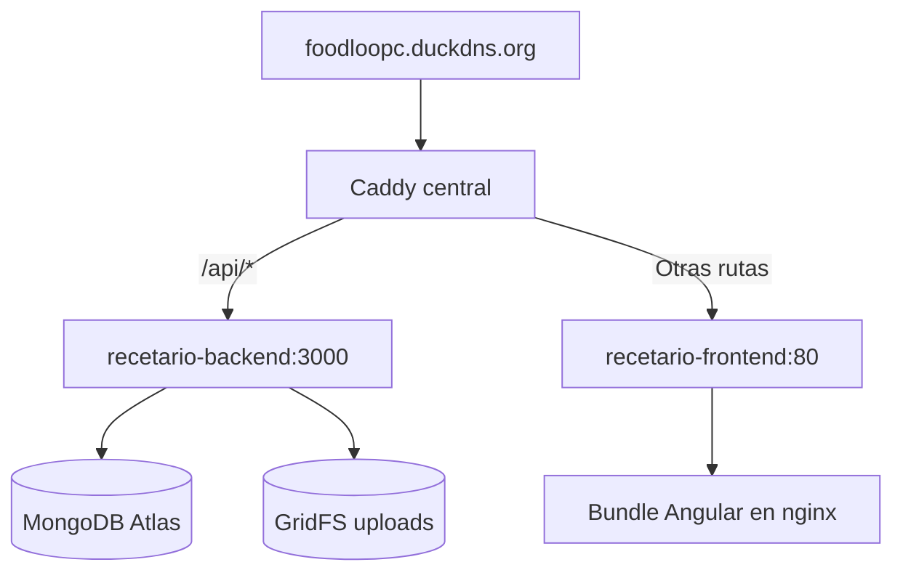
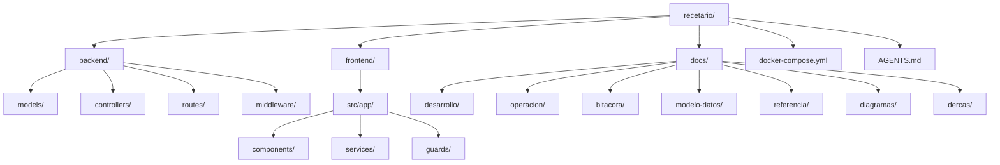

# Diagramas de la aplicación

## Índice

- [Diagrama entidad-relación](diagrama-er.md)
- [Diagramas de flujo](flujo/README.md)
- [Diagramas de casos de uso](casos-uso/README.md)
- [Diagramas de secuencia](secuencia/README.md)
- [Diagramas de estado](estado/README.md)

Los diagramas detallados por proceso sustituyen a los ejemplos básicos anteriores. Conservan las rutas, validaciones y defectos conocidos observados en el código.

## Cómo ver los diagramas

Cada Markdown incluye la imagen `.svg` ya renderizada y, debajo, el código Mermaid
en un bloque plegable. Para verlo en Zed, abre la **vista previa Markdown**
(`markdown: open preview`, `Ctrl+Shift+P`), no el editor de texto plano.

Para regenerar las imágenes tras editar un diagrama:

```bash
npx -y @mermaid-js/mermaid-cli@11 -i diagrama.mmd -o diagrama.svg -b white
```

## Arquitectura local



<details>
<summary>Código Mermaid (editable)</summary>



</details>


## Arquitectura productiva



<details>
<summary>Código Mermaid (editable)</summary>



</details>


## Estructura del proyecto



<details>
<summary>Código Mermaid (editable)</summary>



</details>

