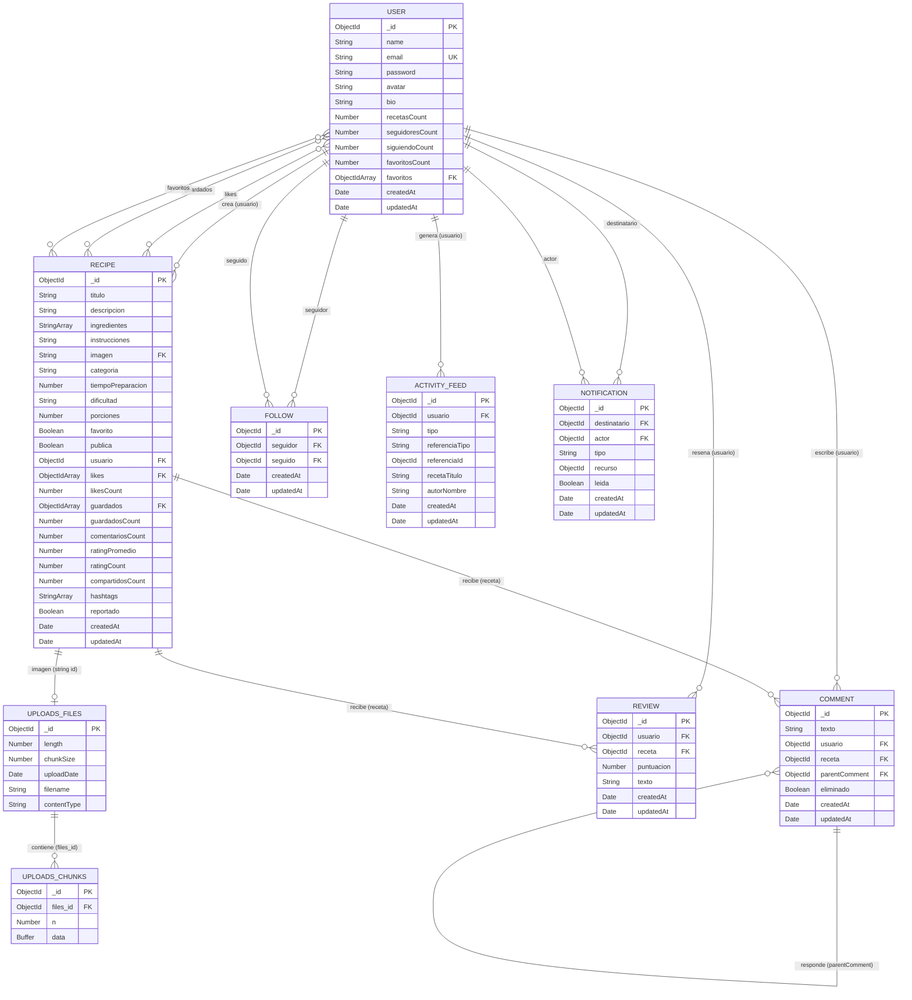

# 🗄️ Diagrama Entidad-Relación (ER) - Colecciones

**Última revisión:** 2026-09-26
**Fuente:** `backend/src/models/*.js` + colecciones GridFS de `uploads`
**Base de datos:** MongoDB 8 (`recetario`)

> Este diagrama refleja los **modelos reales** del código, no la intención de un
> documento previo. Si un campo no está aquí, no existe en el schema.

## Diagrama

Código Mermaid (editable)

> El `%%{init}%%` fuerza etiquetas SVG en vez de `<foreignObject>`. GitHub
> elimina `foreignObject` por seguridad y el diagrama sale en blanco.

## Colecciones y modelos

| Colección | Modelo | Estado |
|---|---|---|
| `users` | `User.js` | ✅ En uso |
| `recipes` | `Recipe.js` | ✅ En uso |
| `comments` | `Comment.js` | ✅ En uso |
| `reviews` | `Review.js` | ✅ En uso |
| `follows` | `Follow.js` | ✅ En uso |
| `activityfeeds` | `ActivityFeed.js` | ✅ En uso |
| `notifications` | `Notification.js` | 🚧 **No implementado** (Fase 7) |
| `uploads.files` | GridFSBucket | ✅ En uso |
| `uploads.chunks` | GridFSBucket | ✅ En uso |

## Relaciones

| Relación | Cardinalidad | Implementación | Borrado |
|---|---|---|---|
| `Recipe.usuario` → `User` | N recetas : 1 usuario | `ObjectId` + `ref` | Requerido (huérfano si se borra el usuario) |
| `Comment.usuario` → `User` | N : 1 | `ObjectId` + `ref` | Requerido |
| `Comment.receta` → `Recipe` | N : 1 | `ObjectId` + `ref` | Requerido |
| `Comment.parentComment` → `Comment` | N : 1 (auto) | `ObjectId` + `ref` | `null` si es de primer nivel |
| `Review.usuario`/`Review.receta` | N : 1 cada uno | `ObjectId` + `ref` | Par único |
| `Follow.seguidor`/`Follow.seguido` | N : 1 cada uno | `ObjectId` + `ref` | Par único |
| `Recipe.likes[]` → `User` | N : N | Array de `ObjectId` | Contador `likesCount` |
| `Recipe.guardados[]` → `User` | N : N | Array de `ObjectId` | Contador `guardadosCount` |
| `User.favoritos[]` → `Recipe` | N : N | Array de `ObjectId` | Contador `favoritosCount` |
| `ActivityFeed.referencia` | Polimórfica | `{ tipo, id }` | Sin `ref` real |
| `Recipe.imagen` → `uploads.files` | 1 : 0..1 | `String` con el `_id` de GridFS | Se limpia al borrar/sustituir |

## Índices declarados

| Colección | Índice | Para qué |
|---|---|---|
| `Comment` | `{ receta: 1, createdAt: -1 }` | Comentarios de una receta ordenados |
| `Comment` | `{ usuario: 1, createdAt: -1 }` | Comentarios de un usuario |
| `Comment` | `{ parentComment: 1 }` | Respuestas a un comentario |
| `Review` | `{ usuario: 1, receta: 1 }` **unique** | Una reseña por usuario y receta |
| `Review` | `{ receta: 1, puntuacion: 1 }` | Calcular promedio |
| `Follow` | `{ seguidor: 1, seguido: 1 }` **unique** | No seguir dos veces |
| `Follow` | `{ seguido: 1, createdAt: -1 }` | Listar seguidores |
| `Follow` | `{ seguidor: 1, createdAt: -1 }` | Listar seguidos |
| `ActivityFeed` | `{ usuario: 1, createdAt: -1 }` | Feed paginado |
| `User` | `{ email }` **unique** | Login sin duplicados |

**Índices que faltan:** `Recipe` no tiene índice para la lista del dashboard
(`{ usuario: 1, createdAt: -1 }`) ni para las públicas (`{ publica: 1, createdAt: -1 }`),
y `Notification` aún no existe.

## Enumeraciones

| Campo | Valores |
|---|---|
| `Recipe.dificultad` | `Fácil`, `Media`, `Difícil` |
| `ActivityFeed.tipo` | `creo_receta`, `comento_receta`, `reseno_receta`, `likio_receta`, `guardo_receta`, `siguio_usuario` |
| `ActivityFeed.referencia.tipo` | `Recipe`, `Comment`, `Review`, `User` |
| `Notification.tipo` (propuesto) | `like`, `comment`, `reply`, `follow`, `review`, `share` |

## Notas

- **`Recipe.imagen` es `String`, no `ObjectId`.** Guarda el `_id` de
  `uploads.files`, con el que se construye `/api/recipes/image/:fileId`. Es la
  única relación que no usa `ref` y por eso se marca como texto libre.
- **Contadores desnormalizados.** `likesCount`, `guardadosCount`,
  `comentariosCount`, `ratingPromedio`, `ratingCount` y `compartidosCount` viven
  en `Recipe` para no recorrer arrays en cada consulta. Si se recalculan mal,
  el número miente aunque el array `likes[]` sea correcto.
- **`ActivityFeed` es un log, no notificaciones.** Registra acciones de forma
  pública y desnormaliza `recetaTitulo`/`autorNombre`. La Fase 7 añadirá
  `Notification`, que sí tiene `destinatario` y `leida`.
- **GridFS.** `uploads.files` guarda los metadatos y `uploads.chunks` los trozos
  de 255 KB. `contentType` vive dentro de `metadata` en el documento real; aquí
  se aplana para que quepa en el diagrama.
- **`Follow` evita auto-seguir** con un `pre("validate")`, y `Review` y `Follow`
  tienen índice único por pareja. No hay borrado en cascada: borrar un `User`
  dejaría sus recetas y comentarios huérfanos.

## Pendiente

- [ ] Cuando se implemente `Notification` (Fase 7), quitar la marca de "no
      implementado" y confirmar sus índices
- [ ] Añadir los índices que faltan de `Recipe`
- [ ] Convertir este diagrama en la especificación de detalle (Fase 8),
      con el ejemplo de documento de cada colección
