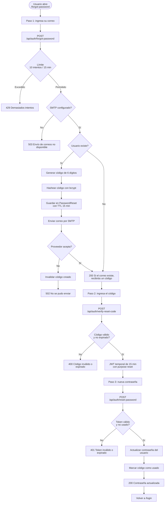

# Recuperación de contraseña

Rutas: `/forgot-password`  
Casos de uso: [Autenticación y sesión](../casos-uso/autenticacion-y-sesion.md)

Código Mermaid (editable)

## Endpoints y validaciones

| Paso | Endpoint | Detalle |
|---|---|---|
| 1. Solicitar | `POST /api/auth/forgot-password` | Sanea `email`. Si falta la configuración global de SMTP responde `503` antes de consultar la cuenta. Si el usuario no existe responde `200` genérico para no revelar su existencia. Si existe, invalida códigos anteriores, genera un código de 6 dígitos, lo hashea con bcrypt y lo guarda con TTL de 15 min. Envía el correo por SMTP; si el proveedor lo rechaza, invalida el código y responde `502`. Cualquier cuenta con email puede recuperarla, incluidas las creadas con Google. |
| 2. Verificar | `POST /api/auth/verify-reset-code` | Valida `email` y `code`. Compara con bcrypt. Devuelve un JWT temporal con `purpose: "reset"` y expiración de 15 min. |
| 3. Restablecer | `POST /api/auth/reset-password` | Valida el token (firma, expiración, purpose). Verifica que el código no haya sido usado ni expirado. Actualiza la contraseña y marca el código como usado. |

## Configuración necesaria

- Definir en `backend/.env`: `SMTP_HOST`, `SMTP_PORT`, `SMTP_SECURE`, `SMTP_USER`, `SMTP_PASS` y `MAIL_FROM`. Gmail exige una contraseña de aplicación.
- Al arrancar, el backend registra si SMTP está configurado; si faltan variables, responde `503` en el paso 1.
- Implementar invalidación de sesiones existentes tras el cambio (opcional).
- Mejorar el envío con un proveedor transaccional y cola de reintentos (opcional).