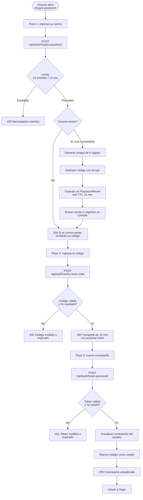

# Recuperación de contraseña

Rutas: `/forgot-password`  
Casos de uso: [Autenticación y sesión](../casos-uso/autenticacion-y-sesion.md)

Código Mermaid (editable)

## Endpoints y validaciones

| Paso | Endpoint | Detalle |
|---|---|---|
| 1. Solicitar | `POST /api/auth/forgot-password` | Sanea `email`. Respuesta genérica para no revelar si la cuenta existe. Invalida códigos anteriores. Genera código de 6 dígitos, lo hashea con bcrypt y lo guarda con TTL de 15 min. Envía correo (o registra en consola si no hay SMTP). |
| 2. Verificar | `POST /api/auth/verify-reset-code` | Valida `email` y `code`. Compara con bcrypt. Devuelve un JWT temporal con `purpose: "reset"` y expiración de 15 min. |
| 3. Restablecer | `POST /api/auth/reset-password` | Valida el token (firma, expiración, purpose). Verifica que el código no haya sido usado ni expirado. Actualiza la contraseña y marca el código como usado. |

## Requisitos pendientes

- Configurar servicio de correo (SMTP o proveedor) en `.env`.
- Añadir variables: `SMTP_HOST`, `SMTP_PORT`, `SMTP_SECURE`, `SMTP_USER`, `SMTP_PASS`, `MAIL_FROM`.
- Implementar invalidación de sesiones existentes tras el cambio (opcional).
- Añadir pruebas unitarias para los 3 endpoints.