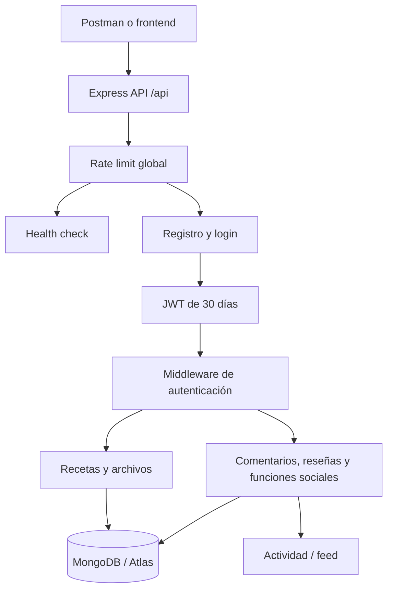

# Análisis de flujos y plan de pruebas de la API

Este documento describe cómo recorrer los flujos funcionales del backend y probar cada endpoint de forma ordenada con Postman o `curl`. Se basa en las rutas y controladores actuales de `backend/src`.

> Las pruebas de escritura alteran la base de datos: registro, creación/eliminación de recetas, comentarios, reseñas, likes, reportes y follows. Usa un entorno de pruebas o cuentas y recetas desechables. La configuración local descrita actualmente usa MongoDB Atlas; verifica cuidadosamente el `MONGODB_URI` antes de ejecutar pruebas con efectos persistentes. No compartas ni incluyas credenciales de `.env` en capturas o documentación.

## 1. Arquitectura y flujo general



- El backend se inicia en `backend/src/server.js`, aplica CORS, parseo JSON y limitador global en `/api`.
- `GET /api/health` informa el estado de la conexión a MongoDB.
- `POST /api/auth/register` y `POST /api/auth/login` emiten un JWT con expiración de 30 días.
- Las rutas de recetas (salvo `GET /api/recipes/image/:fileId`) y todas las rutas sociales están protegidas por `Authorization: Bearer <token>`.
- El CRUD de recetas limita las modificaciones a una lista de campos editables y solo permite al propietario actualizar o eliminar su receta.
- Comentarios, reseñas y acciones sociales pueden actualizar contadores y generar actividad de feed.

## 2. Preparar entorno

Para desarrollo local, seguir [`levantar-servicios.md`](./levantar-servicios.md). El backend responde en `http://localhost:3000`. En Postman, importar `postman/Recetario.postman_collection.json` y usar una variable `baseUrl` con valor `http://localhost:3000/api`.

Antes de probar:

1. Asegurar que backend y MongoDB están disponibles.
2. Consultar `GET {{baseUrl}}/health`: se espera HTTP 200, `status: "ok"` y `mongodb: "conectado"`.
3. Crear un usuario de pruebas con correo único (por ejemplo, un alias propio de pruebas) y contraseña de al menos 8 caracteres. La colección existente trae datos de ejemplo fijos; si el correo ya existe, cambiarlo antes de registrar.
4. Guardar los valores devueltos `token` y `_id` como `token` y `userId` en variables de colección/entorno. La colección actual captura estos valores al registrar o iniciar sesión.
5. Para probar follows y visibilidad pública, registrar una segunda cuenta de pruebas y guardar su `_id` como `otherUserId`. Alternar el token para las solicitudes de esa cuenta.
6. En las peticiones protegidas, incluir `Authorization: Bearer {{token}}` y, cuando haya JSON, `Content-Type: application/json`.

Ejemplo de cabecera:

```http
Authorization: Bearer <JWT>
Content-Type: application/json
```

## 3. Catálogo de endpoints

Base: `http://localhost:3000/api`. Todos los endpoints sociales indicados requieren autenticación.

### Salud y autenticación

| Método | Ruta | Auth | Propósito |
|---|---|---:|---|
| GET | `/health` | No | Estado de API y conexión a MongoDB |
| POST | `/auth/register` | No | Crear cuenta y devolver token |
| POST | `/auth/login` | No | Iniciar sesión y devolver token |

Cuerpos de referencia:

```json
{"name":"Usuario Pruebas","email":"usuario-unico@example.test","password":"clave1234"}
```

```json
{"email":"usuario-unico@example.test","password":"clave1234"}
```

Registro exitoso responde HTTP 201; login exitoso HTTP 200. El duplicado de correo y credenciales incorrectas responden HTTP 400 según el controlador.

### Recetas e imágenes

| Método | Ruta | Auth | Propósito |
|---|---|---:|---|
| POST | `/recipes` | Sí | Crear receta |
| GET | `/recipes` | Sí | Listar recetas propias |
| GET | `/recipes?scope=public` | Sí | Listar recetas públicas y propias |
| GET | `/recipes/:id` | Sí | Obtener receta propia o pública |
| PUT | `/recipes/:id` | Sí | Actualizar receta propia |
| DELETE | `/recipes/:id` | Sí | Eliminar receta propia |
| POST | `/recipes/:id/image` | Sí | Subir/reemplazar imagen, `multipart/form-data`, campo `imagen` (ver middleware de upload) |
| GET | `/recipes/image/:fileId` | No | Servir imagen de GridFS |

Campos básicos requeridos al crear: `titulo`, `descripcion`, `ingredientes` (arreglo), `instrucciones`. Campos opcionales incluyen `categoria`, `tiempoPreparacion`, `dificultad`, `porciones`, `publica` y `hashtags`.

Ejemplo:

```json
{
  "titulo": "Ensalada de prueba",
  "descripcion": "Receta temporal para pruebas",
  "ingredientes": ["tomate", "pepino"],
  "instrucciones": "Lavar, cortar y mezclar",
  "categoria": "Ensaladas",
  "tiempoPreparacion": 15,
  "dificultad": "Fácil",
  "porciones": 2,
  "publica": true,
  "hashtags": ["pruebas", "ensalada"]
}
```

La creación responde HTTP 201 y su `_id` debe guardarse como `recipeId`. `GET /recipes` devuelve recetas propias; con `scope=public` incluye además las públicas. `GET /recipes/:id` permite la receta propia o pública. `PUT` debe incluir al menos un campo editable; cuerpos vacíos o con solo campos protegidos responden HTTP 400. Eliminar responde JSON `{ "message": "Receta eliminada" }`.

La carga de imagen debe hacerse como `multipart/form-data` con el campo aceptado por `backend/src/middleware/upload.js`; confirmar allí el nombre del campo antes de ejecutarla. `GET /recipes/image/:fileId` es pública para que el navegador pueda cargar la imagen. La eliminación o sustitución de recetas/imágenes tiene efectos persistentes en MongoDB/GridFS.

### Comentarios

| Método | Ruta | Auth | Propósito |
|---|---|---:|---|
| POST | `/comments` | Sí | Crear comentario o respuesta |
| GET | `/comments/receta/:recetaId` | Sí | Listar comentarios y respuestas |
| PUT | `/comments/:id` | Sí | Editar comentario propio |
| DELETE | `/comments/:id` | Sí | Eliminación lógica del comentario propio |

Ejemplo de creación:

```json
{"texto":"Comentario de prueba","receta":"{{recipeId}}"}
```

Para responder a otro comentario, añadir `"parentComment":"<commentId>"`. La creación incrementa `comentariosCount` y puede generar eventos en actividad. La eliminación marca el comentario como eliminado y decrementa el contador; no borra físicamente el documento.

### Reseñas

| Método | Ruta | Auth | Propósito |
|---|---|---:|---|
| POST | `/reviews` | Sí | Crear reseña |
| GET | `/reviews/receta/:recetaId` | Sí | Listar reseñas de receta |
| PUT | `/reviews/:id` | Sí | Editar reseña propia |
| DELETE | `/reviews/:id` | Sí | Eliminar reseña propia |

Ejemplo de creación:

```json
{"receta":"{{recipeId}}","puntuacion":5,"texto":"Reseña de prueba"}
```

La puntuación debe estar entre 1 y 5; cada usuario solo puede reseñar una receta una vez. Crear, editar o eliminar recalcula `ratingPromedio` y `ratingCount` de la receta.

### Seguimiento de usuarios

| Método | Ruta | Auth | Propósito |
|---|---|---:|---|
| POST | `/follows` | Sí | Alternar follow/unfollow usando `seguidoId` |
| GET | `/follows/followers/:userId` | Sí | Listar seguidores |
| GET | `/follows/following/:userId` | Sí | Listar usuarios seguidos |
| GET | `/follows/check/:userId` | Sí | Verificar si la cuenta autenticada sigue al usuario |

Ejemplo:

```json
{"seguidoId":"{{otherUserId}}"}
```

`POST /follows` es un toggle: la primera llamada crea follow y responde `{"isFollowing":true}`; repetirla elimina el follow y responde `false`. No se puede seguir a uno mismo.

### Acciones sociales sobre recetas

| Método | Ruta | Auth | Propósito |
|---|---|---:|---|
| POST | `/recipes/:id/like` | Sí | Alternar like |
| POST | `/recipes/:id/save` | Sí | Alternar guardado |
| POST | `/recipes/:id/share` | Sí | Incrementar contador de compartidos |
| POST | `/recipes/:id/report` | Sí | Reportar receta; cuerpo opcional `motivo` |

Like y guardado alternan su estado en cada llamada. Share incrementa un contador, no tiene operación inversa. Report añade un reporte y marca la receta como reportada; probar únicamente con receta de pruebas. Las acciones requieren un `recipeId` válido.

### Actividad

| Método | Ruta | Auth | Propósito |
|---|---|---:|---|
| GET | `/activity/feed?page=1&limit=20` | Sí | Feed de actividad de la cuenta y usuarios seguidos |
| GET | `/activity/user/:userId` | Sí | Últimas actividades de un usuario (hasta 50) |

Las actividades surgen de ciertas acciones, como comentarios, reseñas, likes y follows. El feed se pagina con `page` y `limit`.

## 4. Orden sugerido: prueba funcional de extremo a extremo

Esta secuencia prueba los endpoints y verifica los cambios relacionados. Usa dos cuentas (`A` y `B`) y una receta pública creada por `A`.

1. **Disponibilidad:** `GET /health`; confirmar conexión a MongoDB.
2. **Autenticación A:** `POST /auth/register`; guardar token e id. Repetir el registro para comprobar correo duplicado (HTTP 400), luego `POST /auth/login` y verificar token.
3. **Autenticación B:** registrar e iniciar sesión con una segunda cuenta; guardar `otherUserId` y su token para cambiar entre usuarios.
4. **CRUD de recetas A:** con token A, crear receta pública; guardar `recipeId`; listar propias; consultar `?scope=public`; consultar por id; actualizar título; consultar de nuevo para comprobarlo.
5. **Acceso y propiedad:** sin token, solicitar `GET /recipes` y confirmar rechazo de autenticación. Con token B, consultar una receta privada de A y comprobar que no queda expuesta; intentar editar/eliminar receta ajena solo si el caso se puede ejecutar en datos desechables y confirmar rechazo/no modificación.
6. **Comentarios:** con token B, crear comentario a `recipeId`; listar comentarios y guardar id; editarlo y luego eliminarlo; listar otra vez y verificar que ya no aparece. Repetir creación con `parentComment` para comprobar respuestas.
7. **Reseñas:** con token B, crear reseña; listar y verificar promedio/contador en receta; editar y eliminar; confirmar los contadores. Intentar crear segunda reseña de B para la misma receta (esperado HTTP 400).
8. **Follow:** con token A, seguir a B; consultar `check`, `followers` y `following`; revisar la actividad; volver a llamar POST para dejar de seguir y confirmar `false`.
9. **Acciones sobre receta:** con token B, dar like y repetir para quitarlo; guardar y repetir para quitar; compartir una vez y verificar que aumentó el contador; reportar la receta de pruebas.
10. **Actividad:** consultar `/activity/feed` y `/activity/user/:userId`; comprobar eventos generados por las acciones que los crean.
11. **Imagen (opcional):** subir archivo de imagen con la cuenta propietaria; copiar el id de imagen devuelto/guardado en la receta; solicitar `GET /recipes/image/:fileId` sin token; verificar `Content-Type`. Evitar archivos personales.
12. **Limpieza:** eliminar la receta temporal con su propietario. Comentarios y reseñas deben retirarse explícitamente antes; revisar que el archivo de imagen asociado también se haya eliminado. No borrar cuentas compartidas o datos preexistentes.

## 5. Pruebas negativas y de autorización

Además de comprobar respuestas exitosas, probar con datos desechables:

- Falta de `Authorization` o token inválido en rutas protegidas → rechazo de autenticación (normalmente HTTP 401; confirmar middleware actual).
- Registro con correo ya existente → HTTP 400.
- Login con usuario inexistente o contraseña incorrecta → HTTP 400.
- Receta con datos obligatorios faltantes → el modelo rechazará la validación; el controlador actual reporta HTTP 500. Registrar este comportamiento como validación/error a revisar, no asumir HTTP 400.
- `PUT /recipes/:id` sin campos editables → HTTP 400.
- ID de receta/comentario/reseña inexistente o recurso de otro dueño en rutas que comprueban propiedad → HTTP 404.
- Reseña duplicada por la misma cuenta y receta → HTTP 400.
- Follow hacia el mismo usuario → HTTP 400.
- GET de imagen con ObjectId inválido → HTTP 400; id válido sin fichero → HTTP 404.
- Límite de solicitudes: la API aplica limitadores globales y por grupos de rutas; evitar loops de pruebas y documentar HTTP 429 si se alcanza el límite.

Los códigos concretos dependen de los controladores y middleware actuales. Guardar siempre método, ruta, status HTTP, cuerpo enviado, resultado observado y resultado esperado.

## 6. Ejemplos con curl

Health:

```bash
curl -i http://localhost:3000/api/health
```

Login:

```bash
curl -i -X POST http://localhost:3000/api/auth/login \
  -H 'Content-Type: application/json' \
  -d '{"email":"usuario-unico@example.test","password":"clave1234"}'
```

Crear receta (reemplazar el token localmente; no subirlo a Git):

```bash
curl -i -X POST http://localhost:3000/api/recipes \
  -H 'Authorization: Bearer <TOKEN>' \
  -H 'Content-Type: application/json' \
  -d '{"titulo":"Ensalada de prueba","descripcion":"Receta temporal","ingredientes":["tomate","pepino"],"instrucciones":"Cortar y mezclar","publica":true}'
```

> No pegar tokens reales en tickets, capturas compartidas ni archivos versionados.

## 7. Hallazgo validado en Atlas: recetas propias y públicas

En la revisión del 2026-10-17 se comprobó en la base `recetario` que existen 7 recetas, todas con `publica: true`, pero ninguna pertenece al usuario identificado por el JWT usado en la prueba. Por diseño:

- `GET /api/recipes` devuelve únicamente recetas cuyo `usuario` coincide con el usuario autenticado; para esa cuenta el resultado correcto es `[]`.
- `GET /api/recipes?scope=public` incluye las recetas públicas y las propias. La comprobación respondió HTTP 200 y devolvió las 7 recetas.

Durante las primeras consultas Atlas tuvo un timeout temporal; al repetir la solicitud respondió normalmente. Este hallazgo distingue el filtro de autorización/propiedad de un fallo del endpoint. Evitar pegar JWT en documentación; los tokens compartidos deben tratarse como credenciales expuestas.

## 8. Registro de resultados

Copiar esta tabla a una bitácora por ejecución:

| Fecha | Cuenta/entorno | Método y ruta | Resultado esperado | Status observado | Resultado | Observaciones |
|---|---|---|---|---:|---|---|
| | Local / pruebas | `GET /health` | `status=ok`, Mongo conectado | | Pendiente | |

Clasificar cada caso como **Aprobado**, **Fallido** o **Bloqueado**. Para fallos, incluir el identificador de prueba y el mensaje sin credenciales ni datos personales.

## 9. Colección Postman actual y alcance

La colección `postman/Recetario.postman_collection.json` cubre actualmente health, registro/login y CRUD básico de recetas, y guarda automáticamente `token`, `userId` y `recipeId`. No incluye todavía comentarios, reseñas, follow, feed, acciones sociales ni carga de imágenes. Este documento detalla cómo probarlos manualmente; ampliar la colección Postman con esos flujos puede ser el siguiente paso.

## Referencias internas

- Rutas y montaje: `backend/src/server.js`, `backend/src/routes/`.
- Lógica de negocio: `backend/src/controllers/`.
- Esquemas y reglas de campos: `backend/src/models/`.
- Pruebas automatizadas existentes: `backend/test/recipes.test.js` (pruebas unitarias/regresión de rutas y recetas, no suite completa de integración HTTP).
- Arranque local: [`levantar-servicios.md`](./levantar-servicios.md).
- Colección Postman: `postman/Recetario.postman_collection.json`.
